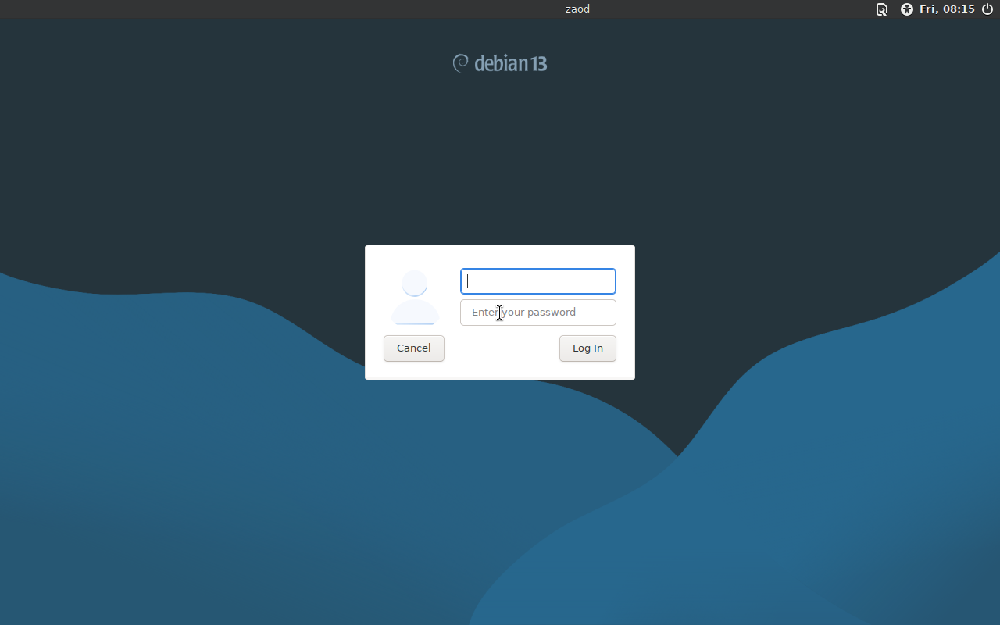

# Zaod OS

A minimal Debian 13 desktop built for light hardware: a browser, a file manager,
working WiFi/Bluetooth/camera drivers and a clean XFCE desktop. Nothing else
padded on top.

Zaod OS is a live ISO. It boots straight into a working desktop on old laptops
and can also run from a USB stick without touching the internal disk.



## Download

The ISO is published as a GitHub Release asset (it is not stored inside the git
tree, because it is 2 GB):

**Latest release:** https://github.com/zaodisnowback-ctrl/zaod-os/releases/latest

| Version | File | Size | SHA-256 |
|---|---|---|---|
| 2026.11.13-v2 (latest) | `Zaod-OS-x86_64.iso` | 2,125,385,728 bytes (1.98 GiB) | `676af3d0a285fc4e0baf2acb892cf5067ef541fa6fdb17e514036b6a8875c2e5` |
| 2026.11.13 (superseded) | `Zaod-OS-x86_64.iso` | 2,125,692,928 bytes (1.98 GiB) | `8da968573b8f79c7611324abd32d2c2670a92df2d21d61c0d4f7638af6efc6d4` |

Always verify the checksum before flashing:

```bash
sha256sum Zaod-OS-x86_64.iso
```

On Windows PowerShell:

```powershell
Get-FileHash .\Zaod-OS-x86_64.iso -Algorithm SHA256
```

## Requirements

- 64-bit x86 machine (AMD / Intel). No ARM build.
- 2 GB RAM minimum, 4 GB recommended.
- USB stick of 4 GB or larger.
- **Secure Boot must be OFF.** The image boots through GRUB with no shim
  signature, so it will not load while Secure Boot is enforced.
- BIOS/legacy boot and UEFI boot are both supported (hybrid ISO).

## Boot it

1. Flash the ISO to a USB stick (Rufus in DD mode, balenaEtcher, or `dd`).
2. Disable Secure Boot in the firmware settings.
3. Pick the USB device and choose **Zaod OS (live)** in the GRUB menu.
4. Log in with user `user` and password `live`.

Full step-by-step instructions, including the exact Linux / Windows flashing
commands and firmware settings, are in [docs/INSTALL.md](docs/INSTALL.md).

## What is inside

- Base: Debian 13 (trixie), kernel 6.12.116, hybrid BIOS + UEFI boot
- Desktop: XFCE with LightDM
- Browser: Firefox ESR
- Files: Thunar, Xarchiver
- Drivers: free and non-free WiFi, Bluetooth, GPU and camera firmware included,
  NetworkManager + Blueman for control
- Media: Audacious, Parole, Ristretto, Cheese, PipeWire audio
- Tools: Mousepad, Vim, terminal, Python 3.13, screenshot, task manager
- Branding: Zaod Plymouth boot animation, wallpaper, desktop launcher,
  onboarding and a system monitor panel

Office, games and app stores are deliberately left out to keep the image small.

## Documentation

| Document | Contents |
|---|---|
| [docs/INSTALL.md](docs/INSTALL.md) | Flashing, firmware setup, first boot, live vs installed use |
| [docs/DEVELOPER-GUIDE.md](docs/DEVELOPER-GUIDE.md) | Architecture, build recipe, branding assets, release and checksum process |
| [docs/KNOWN-ISSUES.md](docs/KNOWN-ISSUES.md) | Verified defects in the current ISO and what is being fixed |
| [docs/CHANGELOG.md](docs/CHANGELOG.md) | Release history and checksums |
| [SECURITY.md](SECURITY.md) | Reporting a vulnerability |

## Source code

Build sources (live-build recipe, branding assets, installer scripts, helper
tools) are **not** published in this repository. They are kept in a private
archive and are available only to the Zaod OS owner and to people the owner
grants access to. See [docs/DEVELOPER-GUIDE.md](docs/DEVELOPER-GUIDE.md#source-access).

## License

**Proprietary. All rights reserved.** See [LICENSE](LICENSE).

You may download this ISO and run it on your own machines. You may not copy,
mirror, re-publish, redistribute, sell, rebrand, fork or build derivative
products from this ISO or any Zaod OS source code without written permission
from the owner. Commercial use is not granted.

Zaod OS bundles unmodified Debian packages, which keep their own upstream
licenses and copyrights. Nothing here restricts the rights those licenses give
you in Debian, XFCE, Firefox, Linux or any other bundled component.
