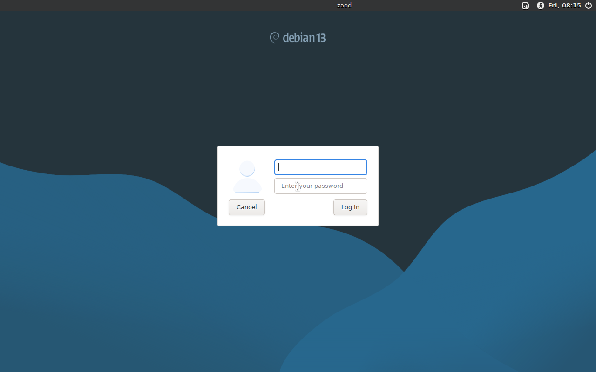

# Installing and booting Zaod OS

Zaod OS ships as a hybrid ISO image: it boots on both BIOS/legacy and UEFI
firmware, and it runs as a live system from the USB stick.

## 1. Before you start

- Download `Zaod-OS-x86_64.iso` from
  [Releases](https://github.com/zaodisnowback-ctrl/zaod-os/releases/latest).
- Verify the SHA-256 hash matches the table in the [README](../README.md).
- Use a USB stick of 4 GB or more. **Everything on that stick will be erased.**
- Make sure Secure Boot can be turned off on your machine.

## 2. Verify the download

Linux:

```bash
sha256sum Zaod-OS-x86_64.iso
```

macOS:

```bash
shasum -a 256 Zaod-OS-x86_64.iso
```

Windows (PowerShell):

```powershell
Get-FileHash .\Zaod-OS-x86_64.iso -Algorithm SHA256
```

If the hash does not match, download again. Do not flash a mismatched image.

## 3. Flash the USB stick

### Windows

Use **Rufus** and select **DD image mode** when it asks (ISO mode sometimes
breaks the hybrid boot record), or use **balenaEtcher**, which handles the
image correctly by default.

### Linux / macOS

```bash
lsblk                      # find your USB device, e.g. /dev/sdb - check twice
sudo umount /dev/sdb* 2>/dev/null
sudo dd if=Zaod-OS-x86_64.iso of=/dev/sdb bs=4M status=progress oflag=sync
sync
```

`/dev/sdb` is an example. Writing to the wrong device destroys that disk.

## 4. Firmware settings

Enter the firmware setup (usually `F2`, `F10`, `Del` or `Esc` at power on) and
set:

- **Secure Boot: Disabled.** Required. The image has no signed shim.
- **Boot mode: UEFI** (preferred) or **Legacy/CSM**. Both work.
- **SATA mode: AHCI**, not RAID/RST, or the disk will not be detected.
- USB boot enabled, and the USB device first in the boot order
  (or use the one-time boot menu, typically `F12` / `F9` / `Esc`).

## 5. Boot the ISO

1. Insert the stick and power on.
2. In the GRUB menu choose **Zaod OS (live)**.
   
3. The Plymouth boot animation runs while the squashfs image loads. On 2 GB RAM
   machines this takes roughly 40-90 seconds from a USB 2.0 stick.
4. LightDM appears with the Zaod greeter.
   

## 6. Logging in

| Field | Value |
|---|---|
| Username | `user` |
| Password | `live` |

The current build does **not** have autologin enabled, so the login screen is
shown. Automatic login is on the fix list in
[KNOWN-ISSUES.md](KNOWN-ISSUES.md).

## 7. Running it

- Live mode: nothing is written to the internal disk. Settings and files inside
  the live session are lost on shutdown.
- Persistent use: create a second partition labelled `persistence` and add
  `persistence` to the kernel command line in GRUB if you want changes to
  survive a reboot.
- Installing to an internal disk is **not available yet.** The GRUB entry
  "Install Zaod OS to disk" points at an installer stage that is not included
  in this image, so it will fail. Install Debian 13 and apply the Zaod layer
  manually, or wait for the installer build. Details in
  [KNOWN-ISSUES.md](KNOWN-ISSUES.md).

## 8. Troubleshooting

| Symptom | Cause | Fix |
|---|---|---|
| Firmware refuses to boot the stick | Secure Boot still on | Disable Secure Boot, or boot in legacy/CSM mode |
| Black screen after GRUB | GPU driver/nomodeset issue | Add `nomodeset` to the kernel line in GRUB, press `e` to edit |
| No WiFi networks listed | Firmware not loaded for that card | Run `dmesg \| grep -i firmware` and check the card against the supported list in the developer guide |
| "Install Zaod OS to disk" errors out | Installer not included in this build | Use live mode only, see Known issues |
| System feels very slow | 2 GB RAM, USB 2.0 stick | Close Firefox tabs, boot from USB 3.0, or use 4 GB RAM |
